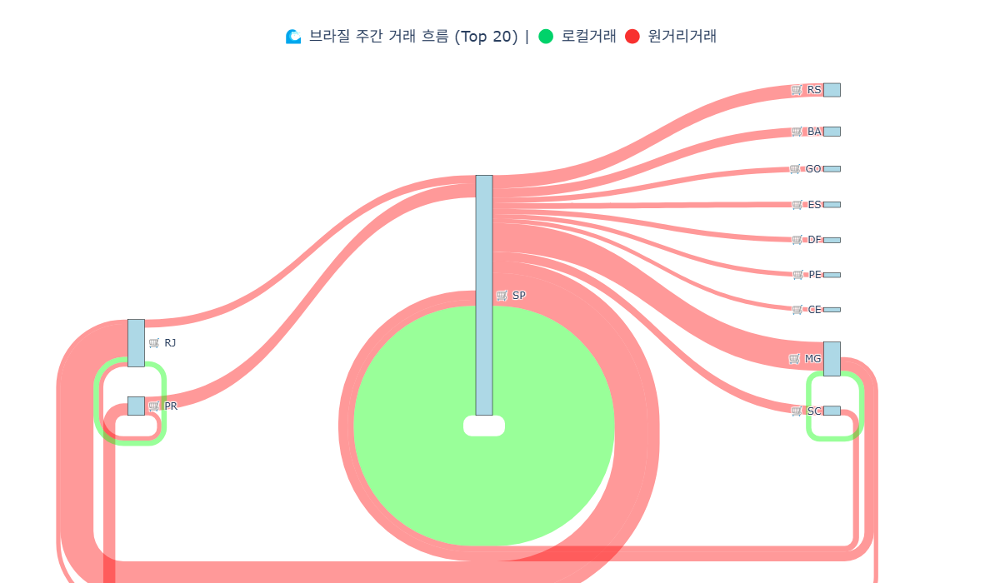
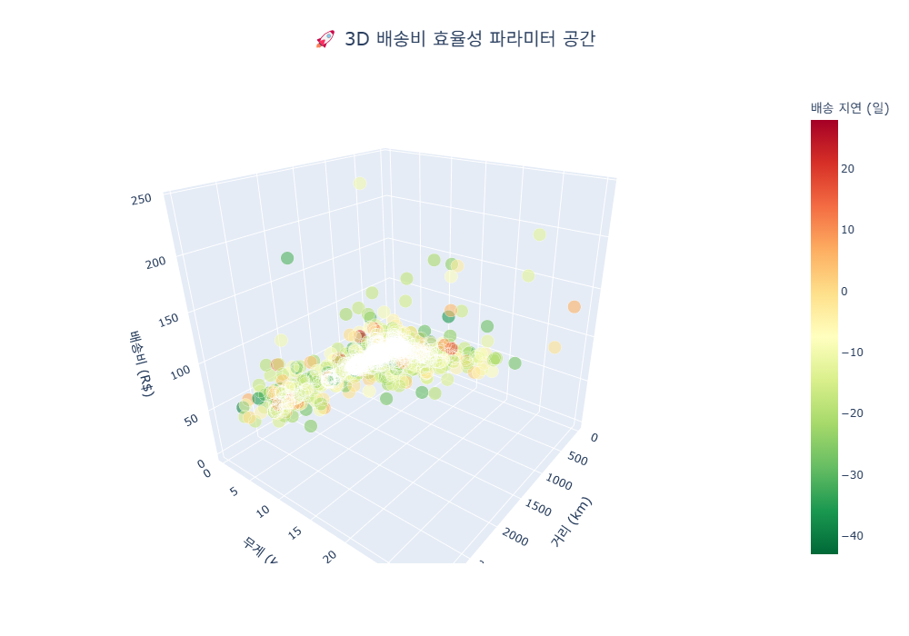

# Brazilian E-Commerce by Olist

### SQL 데이터마트와 인터랙티브 시각화로 살펴본 고객 행동·배송 경험

브라질 이커머스 **Olist**의 주문·고객·상품·판매자·배송·리뷰 데이터를 연결해 고객 유지와 운영 개선 과제를 분석한 프로젝트입니다.

Docker·MySQL 기반 분석 환경을 구성하고, SQL로 목적별 데이터를 설계한 뒤 Python으로 RFM·코호트·지역별 거래·배송·리뷰 분석을 수행했습니다. **지표 설계부터 시각화 화면 구현까지 연결해, 복잡한 데이터를 비교하고 설명할 수 있는 형태로 전달하는 데 집중했습니다.**

## 프로젝트 목표

거래 규모만으로는 고객의 반복 구매와 서비스 경험을 충분히 설명하기 어렵습니다. 다음 질문을 중심으로 분석했습니다.

| 분석 질문 | 접근 방법 | 결과 전달 방식 |
| --- | --- | --- |
| 고객은 얼마나 반복 구매하는가? | 구매횟수·생애주기·코호트 분석 | 고객 유형 분포, 리텐션 히트맵 |
| 어떤 고객군을 우선 관리해야 하는가? | RFM·KMeans·구매 카테고리 비교 | PCA, 고객군 히트맵·레이더 |
| 지역 간 거래와 배송 경험은 어떻게 다른가? | 지역 연결, 거리·배송일·배송비 분석 | Sankey·네트워크·지도·산점도 |
| 평점만으로 만족도를 설명할 수 있는가? | 텍스트 분석, 평점–감정 분류 비교 | 혼동행렬, 단어 계수, 리뷰 사례 |
| 판매자 확보 과정의 차이는 무엇인가? | MQL·계약 전환·거래 성과 연결 | 채널별 비교와 성과 예측 탐색 |

## 주요 수행 내용

- Docker Compose로 MySQL 8.0 분석 환경 구성
- pandas·SQLAlchemy 기반 CSV 적재 코드 및 테이블별 점검 SQL 작성
- JOIN·GROUP BY·CASE·CTE·윈도 함수를 활용한 분석 데이터 구성
- 고객 식별키를 구분한 구매 이력, RFM, 고객군 및 코호트 분석
- 지역 간 거래 흐름과 거리·배송비·배송 성과 시각화
- 포르투갈어 리뷰의 TF-IDF·로지스틱 회귀 분석과 해석
- Plotly subplot·hover를 활용한 인터랙티브 분석 화면 구현
- Tableau Public 연계를 위한 분석·차원·집계 CSV 14종 설계 및 추출 코드 작성

## 기술 스택

| 구분 | 기술 | 사용 목적 |
| --- | --- | --- |
| 분석 환경 | Docker, MySQL 8.0 | 적재·조회와 SQL 분석 |
| 데이터 처리 | Python, pandas, NumPy, SQLAlchemy | 병합·집계·날짜 처리·SQL 실행 |
| 시각화 | Plotly, Matplotlib, Seaborn | 비교·분포·시간·공간·흐름 표현 |
| 네트워크 | NetworkX | 지역 간 거래 연결 구조 |
| 고객 분석 | scikit-learn | StandardScaler, KMeans, PCA |
| 리뷰 분석 | TF-IDF, LogisticRegression, NLTK | 포르투갈어 텍스트 처리와 분류 |
| BI 연계 | Tableau Public용 CSV | 대시보드에 사용할 데이터 전달 |

## 데이터와 분석 단위

Olist가 공개한 브라질 이커머스 및 마케팅 퍼널 데이터를 사용했습니다.

- [Brazilian E-Commerce Public Dataset by Olist](https://www.kaggle.com/datasets/olistbr/brazilian-ecommerce)
- [Marketing Funnel by Olist](https://www.kaggle.com/datasets/olistbr/marketing-funnel-olist)

| 데이터 | 원본 행 수 | 관측 내용 |
| --- | ---: | --- |
| Orders | 99,441 | 주문 상태와 주문·배송 시점 |
| Order Items | 112,650 | 상품·판매자·가격·배송비 |
| Customers | 99,441 | 주문별 고객 ID와 고유 고객 식별자 |
| Payments | 103,886 | 주문별 결제 |
| Reviews | 99,224 | 평점·리뷰 텍스트 |
| Products | 32,951 | 카테고리·무게·크기 |
| Sellers | 3,095 | 판매자와 지역 |
| Geolocation | 1,000,163 | 우편번호별 위경도 |
| Category Translation | 71 | 카테고리 영문명 |
| Marketing Qualified Leads | 8,000 | 유입 채널과 최초 접촉일 |
| Closed Deals | 842 | 계약 및 판매자 특성 |

`customer_id`는 주문에 연결되는 고객 ID이며, 반복 구매 분석에는 `customer_unique_id`를 사용합니다. 주문상품·결제·리뷰에는 주문당 여러 행이 존재할 수 있으므로 원천 행 수와 고유 주문 수를 구분합니다. 노트북마다 주문 상태·기준일·금액 포함 범위가 다를 수 있습니다.

## 분석 흐름

1. Docker·MySQL 환경과 원천 테이블 준비
2. 구조·결측·날짜·관계키 점검 및 CSV 적재
3. 고객·매출·상품·판매자 등 목적별 SQL 작성
4. RFM·코호트·지역·배송·리뷰·리드 분석
5. 질문에 맞는 차트와 인터랙티브 화면 구현
6. Tableau Public용 CSV 추출 구조 설계
7. 고객 유지·재활성화와 운영 점검 대상으로 결과 연결

## 1. SQL 데이터마트와 지표 설계

원천 테이블을 분석 질문별로 연결하고 고객·주문·상품 등 집계 단위를 구분했습니다. 주문별 상품금액·배송비, 상품·카테고리·판매자별 성과, 고객별 RFM·생애주기·활동 상태, 리드 전환을 분석하는 SQL을 작성했습니다.

초기 SQL 마트와 이후 고객 분석은 구성과 식별키가 일부 다릅니다. 고객 분석에서는 `customer_unique_id`로 구매 이력을 연결하고 `COUNT(DISTINCT order_id)`로 구매횟수를 계산했습니다.

**코드:** [SQL 데이터마트](00.preprocess/olist_data_marts.sql) · [원천 점검 SQL](00.preprocess/DW_query/) · [관계 점검](00.preprocess/relation_check.sql)

## 2. RFM·고객군·코호트 분석

RFM과 최근 활동 상태로 고객 특성을 비교하고, 표준화·KMeans·PCA 시각화를 수행했습니다. 군집별 구매금액·최근 활동·선호 카테고리를 함께 비교해 고객군을 관리 방향으로 해석했습니다.

코호트 분석에서는 첫 구매 월과 이후 구매 월을 연결해 경과 월별 구매 활동을 히트맵으로 비교했습니다. 고객군과 첫 구매 특성에 따른 차이도 탐색했습니다.

**주요 발견:** 고객 여정 분석에서 **1회 구매 고객 비중이 약 97%**인 구조를 확인했습니다. 관측 기간의 구매 이력에 대한 결과이며, 고객 획득과 함께 재구매·재활성화 과제를 살펴볼 필요가 있음을 보여줍니다. 마지막 구매 이후 90일 초과 여부는 구매 공백 지표이며 실제 이탈 확정값과 구분합니다.

**코드:** [동적 RFM](01.analysis/01_RFM/동적RFM.ipynb) · [행동 인사이트](01.analysis/01_RFM/행동인사이트.ipynb) · [코호트](01.analysis/02_Cohort/) · [고객 여정](01.analysis/04_Olist/고객여정.ipynb)

## 3. 지역 간 거래와 배송 성과

판매자와 고객의 지역을 연결해 동일 지역 거래와 지역 외 거래를 비교했습니다. 주요 거래액 흐름은 Sankey로, 지역의 연결 구조는 네트워크로 표현했습니다.

우편번호별 대표 좌표와 Haversine 공식으로 고객–판매자 직선거리를 계산하고, 거리·배송비·배송일·지연·상품 무게·부피를 함께 비교했습니다. 직선거리는 실제 운송 경로 거리와 구분합니다.

### 시각화 예시

**지역 간 거래 흐름**



**지역별 배송 성과**


**배송비 효율성**



**코드:** [판매자–고객 연결](01.analysis/05_region/seller_customer.ipynb) · [배송비](01.analysis/05_region/배송비.ipynb) · [배송 성과](01.analysis/05_region/배송성능.ipynb)

## 4. 리뷰 텍스트와 고객 경험

평점 1~2점을 부정, 4~5점을 긍정으로 정의하고 3점 리뷰를 제외한 분류 데이터를 구성했습니다. 포르투갈어 소문자화·문자 정제·불용어 제거 후 TF-IDF와 로지스틱 회귀를 적용했습니다.

혼동행렬과 단어 계수로 결과를 해석하고, 높은 평점에도 내용이 부정으로 분류된 리뷰를 추출했습니다. 평점만으로 드러나지 않는 고객 경험의 추가 점검 후보이며 실제 불만이 확정된 결과는 아닙니다.

**코드:** [리뷰 분석](01.analysis/06_Review/01.리뷰분석.ipynb) · [감정 분류](01.analysis/06_Review/02.감정예측.ipynb)

## 5. 시각화·대시보드 구현

### 질문에 맞는 차트 선택

| 표현할 정보 | 시각화 | 설계 목적 |
| --- | --- | --- |
| 고객군별 행동 | 히트맵·레이더·PCA | 분포와 고객군 특성 비교 |
| 시간에 따른 구매 | 코호트 히트맵 | 첫 구매 이후 활동 비교 |
| 지역 간 거래액 | Sankey | 공급–수요 지역의 흐름 설명 |
| 거래 연결 구조 | 네트워크 | 주요 연결과 집중 지역 탐색 |
| 지역별 배송 | 지도·비교 차트 | 주문 규모와 운영 성과 비교 |
| 거리·비용·시간 | 산점도·구간 히트맵 | 관계와 분포 탐색 |
| 리뷰 분류 | 혼동행렬·계수 차트 | 오류와 분류 근거 해석 |

### 인터랙티브 분석 화면

Plotly의 `express`, `graph_objects`, `make_subplots`로 관련 차트를 함께 배치하고 hover 정보로 세부 값을 확인하도록 구현했습니다. 색상·버블 크기·링크 폭이 나타내는 지표를 구분해 전달했습니다.

### Tableau Public 연계 데이터 설계

화면에 필요한 데이터의 목적을 나누어 **14종 CSV 출력 구조**를 설계했습니다.

| 구분 | 설계한 출력 |
| --- | --- |
| 분석용 6종 | 프로젝트 개요, KPI, 만족도, 리뷰·배송, 고객 세그먼트, 액션 플래너 |
| 차원용 4종 | 고객, 시간, 지역, 카테고리 |
| 집계용 4종 | 월별 KPI, 지역별·카테고리별·세그먼트별 성과 |

SQL 실행과 CSV 저장을 함수로 구성하고 UTF-8 BOM 인코딩, 행·열 수·실행 시간 출력을 포함했습니다. **분석 데이터 구성과 시각화 화면 설계를 연결한 경험**이 핵심입니다.

저장소에는 Python 분석 화면과 Tableau 연계 추출 코드가 포함돼 있습니다. Tableau 완성 워크북·공개 대시보드 링크는 포함돼 있지 않으며, 저장된 전체 실행 출력에는 일부 CSV 추출 오류가 기록돼 있습니다. 14종은 설계 범위입니다.

**코드:** [대시보드 연계 데이터 생성](02.ad_hoc/00.데이터마트생성.ipynb)

## 분석에서 제안한 방향

- **고객 유지:** 1회 구매 중심 구조를 바탕으로 고객군별 재구매·재활성화 과제 검토
- **고객 관리:** 구매금액·최근 활동·카테고리 특성이 다른 고객군별 관리 방향 제안
- **배송 운영:** 거래 흐름과 거리·배송 성과를 함께 비교해 지역·경로별 점검 대상 제안
- **고객 경험:** 평점과 리뷰 내용이 다른 사례를 추가 검토할 후보로 제시

공개 데이터 기반 분석과 제안이며 실제 매출·리텐션 개선이나 배송비 절감 성과를 의미하지 않습니다.

## 저장소 구성

| 경로 | 내용 |
| --- | --- |
| [`00.preprocess/`](00.preprocess/) | 적재, 점검 SQL, 데이터마트, ERD |
| [`01.analysis/01_RFM/`](01.analysis/01_RFM/) | RFM·군집·고객 행동 |
| [`01.analysis/02_Cohort/`](01.analysis/02_Cohort/) | 코호트·첫 구매 특성 |
| [`01.analysis/03_Segmentation/`](01.analysis/03_Segmentation/) | 고객 특성 기반 세분화 |
| [`01.analysis/04_Olist/`](01.analysis/04_Olist/) | 매출·가격·지역·판매자·고객 여정 |
| [`01.analysis/05_region/`](01.analysis/05_region/) | 거래·거리·배송 분석 및 이미지 |
| [`01.analysis/06_Review/`](01.analysis/06_Review/) | 리뷰·감정 분류 |
| [`01.analysis/07_Marketing/`](01.analysis/07_Marketing/) | 리드·전환·성과 예측 탐색 |
| [`02.ad_hoc/`](02.ad_hoc/) | Tableau 연계 데이터 추출 |
| [`db/init.sql`](db/init.sql) | 초기 테이블 정의 |
| [`docker-compose.yml`](docker-compose.yml) | MySQL 컨테이너 설정 |

## 실행 안내

SQL과 노트북 중심의 분석 작업 기록입니다. 원본 CSV는 별도로 준비해야 합니다. 아래는 환경 준비 순서이며 전체 분석을 한 번에 완료하는 명령은 제공하지 않습니다.

### 1. 저장소와 Python 환경

```bash
git clone https://github.com/yeoyun/Brazilian-E-Commerce-by-Olist.git
cd Brazilian-E-Commerce-by-Olist
python -m venv .venv
```

가상환경 활성화 후 주요 패키지를 설치합니다. 버전이 고정된 환경 파일은 아직 포함돼 있지 않습니다.

```bash
pip install pandas numpy sqlalchemy pymysql mysql-connector-python matplotlib seaborn plotly networkx scikit-learn nltk jupyter
```

### 2. MySQL 실행

```bash
docker compose up -d
```

Compose 기준 DB 이름은 `olist_dw`, 로컬 포트는 `3307`입니다. 연결 정보는 Compose와 각 코드의 설정을 일치시킵니다.

### 3. 데이터·스키마 준비

- 루트에 `data/` 폴더를 만들고 원본 파일명으로 CSV를 배치합니다.
- 적재 스크립트는 `_raw` 테이블을 사용합니다. 원천 테이블과 파일 매핑을 먼저 준비합니다.
- `00_load_data_to_mysql.py`의 현재 활성 매핑은 계약 데이터 한 종입니다. 나머지 매핑은 확인 후 활성화합니다.
- 적재는 `append` 방식이므로 반복 실행 전에 기존 적재 여부를 확인합니다.
- `db/init.sql`은 초기 스키마입니다. 계약 테이블의 `mql_id` 등 후속 분석에 필요한 컬럼과 리뷰 키 중복 처리 기준을 대조해 사용합니다.
- `DW_query/`의 점검·처리 SQL은 일부 테이블명도 환경에 맞게 확인해야 합니다.

### 4. 분석 실행

- 적재 스크립트는 `00.preprocess/`에서 실행해 `../data` 상대경로를 맞춥니다.
- 원천 적재 이후 분석에서 사용하는 정제 테이블과 데이터마트를 준비합니다.
- 노트북의 DB 연결·파일 경로를 맞추고 선행 데이터 생성 셀부터 실행합니다.
- 일부 셀은 이전 결과나 로컬 파일을 참조하므로 입력을 확인합니다.
- CSV 추출 시 `02.ad_hoc/` 기준 저장 경로와 실행 로그를 확인합니다.

## 결과 해석과 검증 범위

- 저장된 출력은 과거 실행 결과입니다. 데이터 버전·주문 상태·기준일에 따라 값이 달라질 수 있습니다.
- 상품·결제·리뷰 조인 시 행 증폭과 집계 단위·분모를 확인해야 합니다.
- 동적 RFM은 구매 발생 월의 지표를 포함하며 무구매 월까지 채운 월말 스냅샷과 구분합니다.
- 리뷰 모델은 TF-IDF 학습과 데이터 분할 순서를 보완한 재평가가 필요합니다. 저장된 점수를 검증 완료 성능으로 제시하지 않습니다.
- 리드 예측은 탐색 분석입니다. 병합 후 고유키·행 수와 확률 해석을 추가 검증해야 합니다.

## 프로젝트에서 다룬 역량

**SQL 데이터 설계 → 고객·운영 분석 → 시각화 구현 → 결과 해석과 제안**을 연결했습니다.

분석 질문에 맞는 지표와 차트를 선택하고 고객 행동·거래 흐름·배송 경험을 비교할 수 있는 화면으로 구현했습니다. 데이터 추출뿐 아니라 복잡한 결과를 이해 가능한 정보로 구성하고 설명하는 역량을 다룬 프로젝트입니다.

## 라이선스

저장소 코드는 [LICENSE](LICENSE)를 따릅니다. 원본 데이터의 이용 조건은 데이터 제공 페이지를 확인해주세요.
