# Olist 이커머스의 고객 행동·배송 성과 분석 및 시각화 대시보드 구현

**SQL 데이터 설계부터 고객·배송·리뷰·셀러 분석, Plotly 분석 화면과 발표 시각화까지 전 과정을 단독 수행한 프로젝트입니다.**

브라질 이커머스 Olist의 주문·고객·상품·판매자·배송·리뷰와 마케팅 리드 데이터를 연결해 고객 유지와 운영 개선 과제를 분석했습니다. Docker·MySQL 환경과 SQL 데이터마트를 구성한 뒤 RFM·코호트·매출 구조·지역 간 거래·배송·리뷰·셀러 전환을 탐색했습니다.

특히 **분석 질문에 맞는 지표와 차트를 설계하고, 전체 현황에서 고객군·카테고리·지역·리뷰 이슈를 비교할 수 있는 시각화 화면을 구현한 것**이 주요 기여입니다. Plotly 복합 차트·subplot·hover·범례와 발표용 디자인을 직접 구성하고, Tableau 연계 데이터·월별 KPI·What-if 코드까지 작성했습니다. 고객 분석은 리뷰 개선 후보·경제성 시나리오·셀러 활성화 과제로 확장했습니다.

| 항목 | 내용 |
| --- | --- |
| 수행 기간 | 2025.07.28–2025.08.15 · 발표자료 기준 |
| 수행자 | yeoyun · 개인 프로젝트, 전 과정 단독 수행 |
| 담당 범위 | 문제 정의, DB 환경 구축, SQL 전처리·마트 설계, EDA, 고객 세분화, 리뷰 모델링, 경제성 시나리오, 셀러 분석, 시각화·BI 연계 데이터 작성 |
| 데이터 | Olist 이커머스 및 마케팅 퍼널 공개 데이터 |
| 주요 도구 | Python, SQL, MySQL 8.0, Docker, pandas, SQLAlchemy, scikit-learn, NLTK, Plotly, Matplotlib, Seaborn, NetworkX, Tableau Public 연계 CSV |

## 먼저 볼 문서

- [리뷰 텍스트 데이터 분석](#리뷰-텍스트-데이터-분석): 전처리·키워드·TF-IDF·감정 분류와 실제 결과 이미지
- [Tableau 대시보드](#tableau-대시보드와-kpi-구현): KPI Overview 실제 화면과 워크북
- [발표 시각화 갤러리](docs/VISUALIZATIONS.md): PPT에 사용한 그래프, 시각화 설계, Plotly 원본 연결
- [분석 구성과 코드 안내](docs/ANALYSIS_GUIDE.md): 각 분석의 질문, 방법, 구현 파일
- [지표 근거와 해석 범위](docs/METRICS_AND_LIMITATIONS.md): 주요 수치의 출처, 분모, 발표자료와 코드의 차이
- [환경 준비와 재현 안내](docs/REPRODUCIBILITY.md): 데이터·DB·노트북 실행 순서와 현재 제약

## 문제와 분석 흐름

분산된 데이터를 연결해 **“어떤 고객군을 관리하고, 어떤 지역·배송·리뷰 이슈를 점검해야 하는가?”**를 설명하는 것이 목표였습니다. 구매 구조와 운영 경험을 함께 살펴보고, 시각화로 차이를 전달한 뒤 개선안의 경제성과 셀러 활성화까지 검토했습니다.

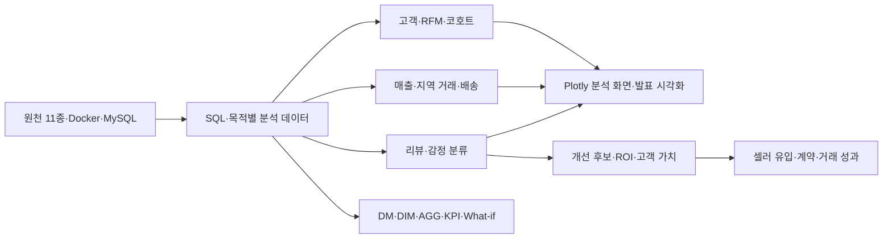

## 리뷰 텍스트 데이터 분석

**평점만으로 설명하기 어려운 고객 경험을 파악하기 위해, 텍스트가 있는 포르투갈어 리뷰 40,950건을 탐색했습니다.** 감정별 단어 빈도와 TF-IDF를 비교하고, 리뷰 단위 분류 모델로 평점과 내용이 다르게 나타나는 사례를 추출했습니다.

### 전처리부터 키워드·감정 분류까지

| 단계 | 직접 수행한 분석 |
| --- | --- |
| 분석 대상 구성 | 비어 있는 메시지 제외, 평점 기준 긍정 4–5점·중립 3점·부정 1–2점 그룹 구성 |
| 포르투갈어 전처리 | 소문자화, 특수문자·숫자 제거, 악센트 보존, 공백 기준 토큰화, 불용어·짧은 토큰 처리 |
| 빈도·키워드 탐색 | 감정별 단어 빈도와 공통 키워드 비교, 상품 등 일반 용어의 노이즈를 줄이고 워드클라우드 구성 |
| 그룹별 TF-IDF | 감정별 리뷰를 합친 3개 문서에서 최대 1,000개 피처로 주요 표현 비교 |
| 리뷰 단위 감정 분류 | 별도 TF-IDF 최대 5,000개 피처와 NLTK 불용어, 로지스틱 회귀 적용. 1–2점·4–5점으로 학습하고 3점은 제외 |
| 해석·후속 분석 | 단어 계수·리뷰 사례 확인, 평점–예측 불일치와 중립 리뷰를 개선 후보로 구성, 구매·배송·이슈별 시나리오와 연결 |

### 감정별 주요 표현을 시각화

단어 빈도 기반 워드클라우드입니다. 긍정·중립·부정 그룹에서 어떤 표현이 두드러지는지 비교했습니다.

| 긍정 리뷰 | 중립 리뷰 | 부정 리뷰 |
| --- | --- | --- |
| 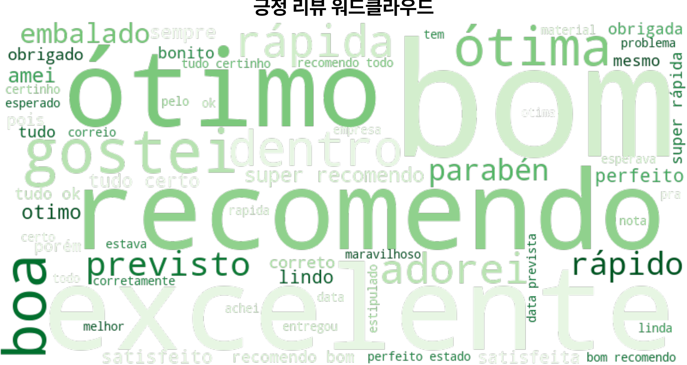 | 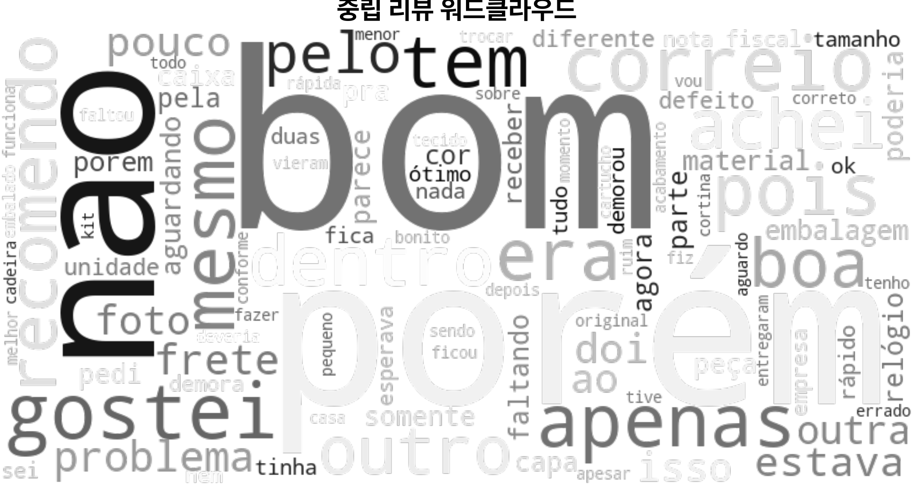 | 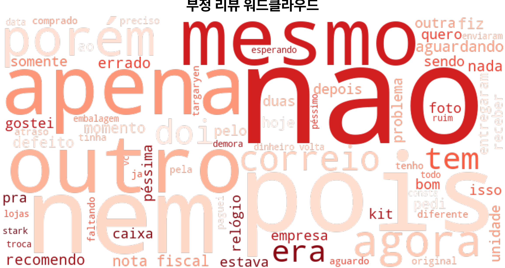 |

단순 출현 빈도와 TF-IDF의 순위를 함께 비교해, 많이 쓰이는 단어와 그룹별 중요 표현을 나눠 살펴봤습니다. 아래는 **원본 노트북에 저장된 비교 그래프**입니다.

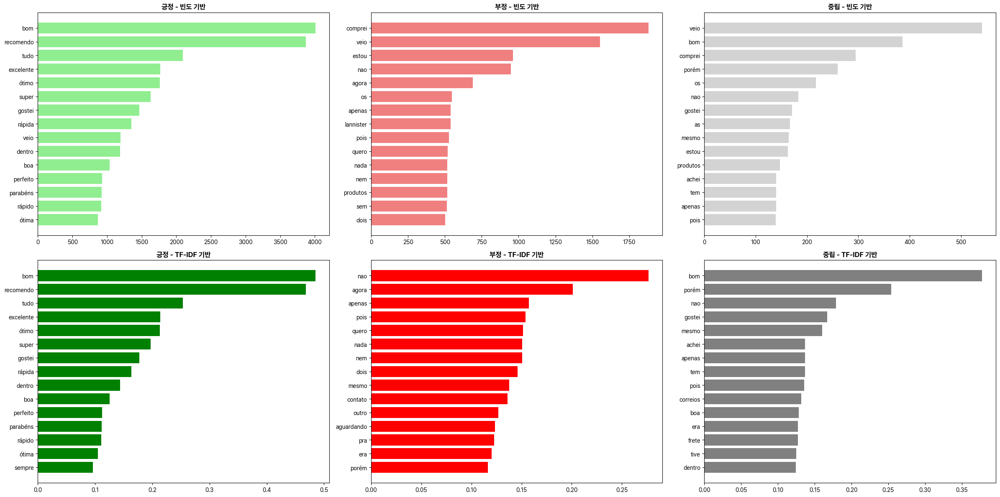

| 그룹 | TF-IDF 주요 표현 · 저장 결과 | 문맥과 함께 검토한 내용 |
| --- | --- | --- |
| 긍정 | `recomendo` 0.469, `excelente` 0.214, `rápida` 0.163 | 추천 의향·품질 평가·빠른 배송 경험 |
| 중립 | `porém` 0.254, `correios` 0.132, `pouco` 0.120 | “하지만” 같은 혼합 평가, 배송 관련 언급·아쉬움 |
| 부정 | `nao` 0.277, `contato` 0.136, `aguardando` 0.124 | 부정 표현, 연락·고객 응대, 기다림과 해결 지연 |

TF-IDF 점수는 그룹별로 합친 문서의 단어 중요도이며 개별 고객의 불만 확률이나 원인의 크기를 뜻하지 않습니다.

### 높은 평점에도 남아 있는 불편 탐색

로지스틱 회귀의 단어 계수와 사례를 살펴본 뒤, **4–5점인데 텍스트는 부정으로 예측된 리뷰 1,223건**을 추출했습니다. 중립 리뷰까지 포함한 후속 개선 후보는 **리뷰 4,780건**이었습니다. 배송·구성품·기대 불일치·색상·고객 응대 관련 표현을 확인하고, 이슈별 개선 비용과 고객 가치 검토로 연결했습니다.

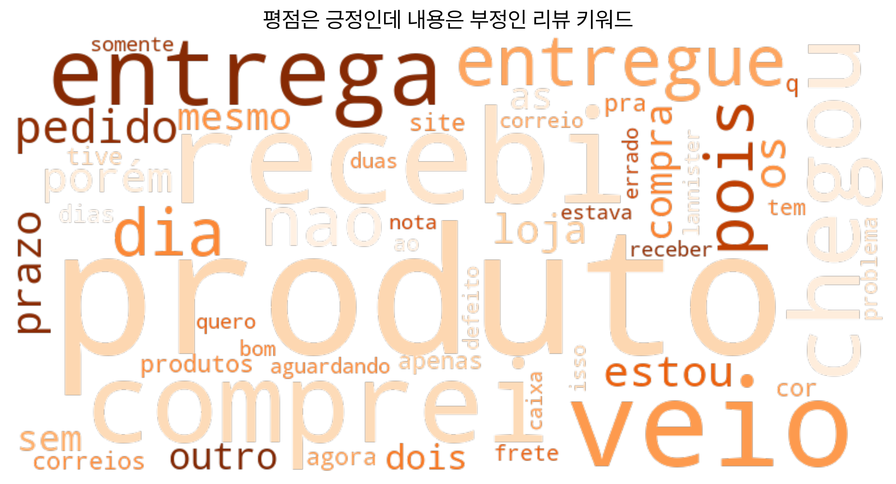

이는 평점 유래 라벨로 학습한 모델이 선별한 검토 후보이며, 사람의 검수로 확정한 불만 고객 수와 구분합니다. 탐색과 분류는 별도 TF-IDF 구성을 사용했습니다. 모델 평가·고객 매핑·저장 결과의 모집단 차이는 [지표 근거](docs/METRICS_AND_LIMITATIONS.md#2-리뷰-분석과-모델)에 기록했습니다.

**원본 코드:** [텍스트 전처리·빈도·TF-IDF·키워드 탐색](01.analysis/06_Review/01.리뷰분석.ipynb) · [감정 분류·계수 해석·불일치 리뷰](01.analysis/06_Review/02.감정예측.ipynb) · [개선 시나리오](01.analysis/06_Review/03.고객시나리오.ipynb)

## 직접 설계한 발표 시각화

분석 결과를 전달하기 위해 **트리맵·복합 차트·지역 네트워크·지도·Sankey·3D·레이더**를 직접 구성했습니다. Plotly의 hover, 범례 선택, 확대·이동을 활용해 전체 구조에서 세부 값까지 확인할 수 있도록 만들고, 색상·강조·텍스트·노드 크기와 연결선을 다듬어 발표 그래프로 사용했습니다.

### 매출 구조와 단가를 함께 설명

카테고리별 매출 비중을 면적으로 표현한 트리맵과, 매출·평균 단가를 함께 배치한 복합 차트입니다. 발표 8쪽에서 판매수량·매출·단가가 서로 다른 정보임을 설명했습니다.

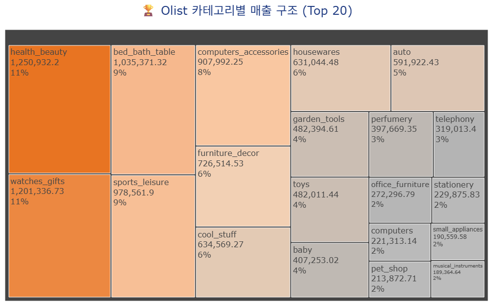

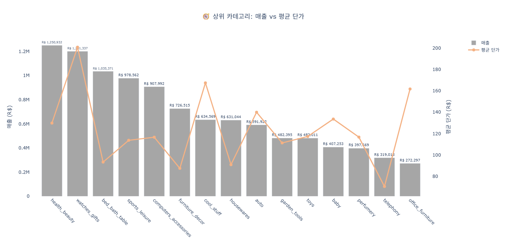

### 판매자와 고객의 지역 연결을 지도 위에 표현

노드 크기 정규화·클리핑, 허브 강조, 연결선의 색·굵기를 조합해 주요 거래 지역과 연결 구조를 보여줍니다. 거래액·건수는 hover로 확인하도록 구성했습니다. 발표 9쪽에 사용한 Plotly 지역 네트워크이며, 강조된 표시 크기는 원시 거래량의 정확한 비례값과 구분합니다.


### 리뷰에서 발견한 이슈를 전략으로 전달

발표 19쪽의 고객군별 부정 요소 비교와 28쪽의 셀러 퍼널입니다. 리뷰 분석과 셀러 분석의 결과를 발표용 시각화로 전달했습니다. 이 두 그림은 Matplotlib 기반이며, 퍼널의 Contact·Qualified 단계는 가정값입니다.

| 고객군별 리뷰 이슈 비교 | 셀러 유입·계약·거래 퍼널 |
| --- | --- |
| 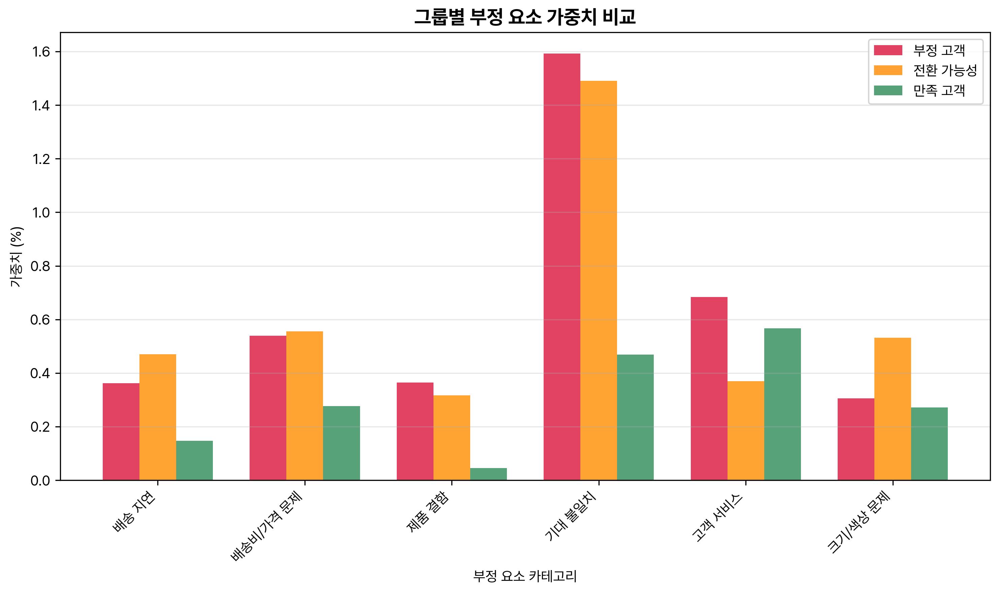 | 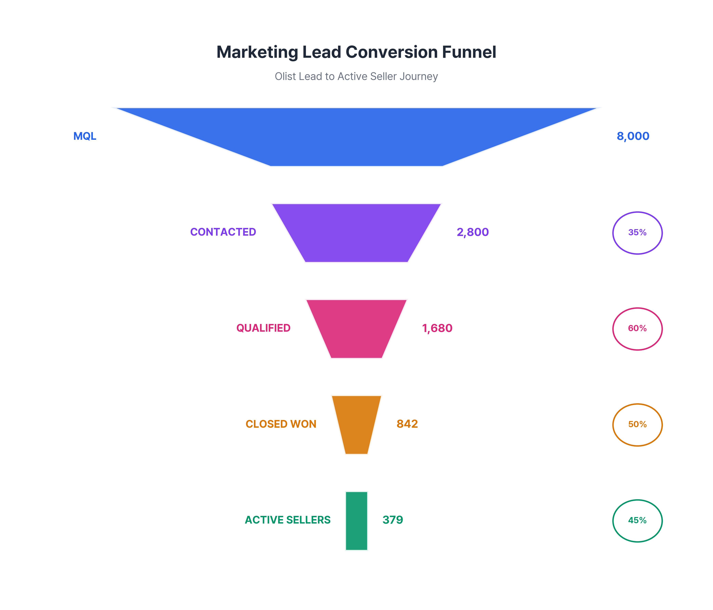 |

**[발표 그래프 전체와 설계 설명 보기](docs/VISUALIZATIONS.md)** · **[Plotly 원본 48개 인터랙티브 뷰어](docs/visualizations/index.html)**

인터랙티브 뷰어는 저장소를 내려받아 `docs/visualizations/index.html`을 Chrome·Edge에서 열면 사용할 수 있습니다. 노트북에 저장된 데이터와 디자인을 보존했으며, DB 연결 없이 오프라인으로 동작합니다. GitHub 웹에서는 HTML 소스가 표시됩니다.

## 분석에서 다룬 질문과 결과

### 1. 1회 구매 중심 구조에서 고객 경험 개선 과제를 탐색

고객 여정 노트북의 저장 결과에서 **1회 구매 비중은 약 97%, 재구매 비중은 약 3%**였습니다. 고객별 구매횟수·금액·카테고리와 RFM·코호트를 비교했지만, 반복 구매 이력이 적어 구매빈도 중심 세분화만으로는 차이를 설명하기 어려웠습니다. 이에 리뷰와 배송 경험으로 분석을 확장했습니다.

이 비율은 관측 기간과 정제 데이터에 대한 결과입니다. 고객 여정 쿼리의 실제 집계 단위는 `customer_unique_id × customer_state`이며, 원본 CSV 재집계와 분모가 다릅니다. [집계 기준 확인](docs/METRICS_AND_LIMITATIONS.md#1-고객-수와-재구매)

### 2. 지역·거래·배송의 차이를 시각적으로 비교

판매자–고객 지역을 연결해 동일 지역·지역 외 거래와 주요 허브의 연결 구조를 비교했습니다. 우편번호 대표 좌표 사이의 직선거리, 배송일·배송비·지연과 상품 무게·부피를 함께 살펴보고 Sankey·네트워크·지도·히트맵·3D로 표현했습니다. 매출·판매수량·평균 단가도 구분해 카테고리 구조와 운영 맥락을 설명했습니다.

**[분석 코드와 비교 기준](docs/ANALYSIS_GUIDE.md)** · **[시각화 원본](docs/VISUALIZATIONS.md#추가-plotly-분석-화면)**

### 3. 높은 평점에도 추가 점검이 필요한 리뷰가 존재

포르투갈어 리뷰에 TF-IDF와 로지스틱 회귀를 적용했습니다. 평점 1–2점을 부정, 4–5점을 긍정으로 학습하고, 중립인 3점 리뷰와 고평점·부정 예측 리뷰를 살펴봤습니다.

저장된 분석에서는 **4–5점인데 부정으로 분류된 리뷰 1,223건**을 추출했습니다. 중립 리뷰를 포함한 개선 후보는 **리뷰 4,780건**이었습니다. 배송·상품 기대 불일치·가격·크기와 색상·고객 응대 관련 표현을 살펴보며 평점만으로 놓칠 수 있는 경험을 점검했습니다.

이는 모델이 선별한 검토 후보입니다. 사람의 검수로 확정한 불만 고객 수나 실제 전환 성과를 뜻하지 않습니다. [모델과 후보 집계 근거](docs/METRICS_AND_LIMITATIONS.md#2-리뷰-분석과-모델)

### 4. 개선 제안을 ROI·고객 가치 관점에서 다시 검토

기대 불일치, 배송비·가격, 크기·색상 이슈별로 개선 비용과 재구매 가정을 적용했습니다. 시나리오에서는 예상 추가 거래액이 투자비를 충분히 회수하지 못했습니다. 따라서 일괄 보상보다 비용·고객 가치·개선 난이도를 함께 고려해 개입 대상을 좁히는 방향을 제안했습니다.

당시 분석은 누적 구매금액을 CLV 대용치로 활용했습니다. 플랫폼 수수료·마진·개입의 인과효과를 반영한 수익성 검증은 후속 과제입니다. [시나리오 산식과 한계](docs/METRICS_AND_LIMITATIONS.md#3-roi와-clv-시나리오)

### 5. 고객 재구매에서 셀러 활성화로 분석 질문 확장

Olist의 거래 중개 플랫폼 특성을 고려해 **“계약한 판매자가 실제 거래까지 이어지는가?”**를 추가로 살펴봤습니다. `mql_id`로 리드와 계약을, `seller_id`로 계약과 주문상품을 연결했습니다.

정제 DB를 사용한 저장 결과는 **리드 8,000건 → 계약 842건 → 거래가 관측된 판매자 379명**이었습니다. 계약률 약 10.5%와 계약 판매자의 거래 발생 비율 약 45.0%를 구분해, 계약 이후 활성화도 관리할 필요가 있음을 제안했습니다. 관측 기간 밖의 성과와 미관측 거래는 포함하지 않습니다.

원본 CSV로 재집계하면 거래 판매자는 380명입니다. 정제본의 과거 결과와 원본 수치를 구분해 기록했습니다. [셀러 지표 확인](docs/METRICS_AND_LIMITATIONS.md#4-셀러-퍼널과-거래액)

## 구현한 분석 기반

| 영역 | 수행 내용 | 코드 |
| --- | --- | --- |
| 데이터 환경 | Docker·MySQL 구성, CSV 적재, 결측·날짜·관계키 점검, ERD 작성 | [전처리](00.preprocess/), [DB 정의](db/init.sql) |
| 고객 행동 | RFM·KMeans·PCA, 코호트, 첫 구매 특성, 고객 여정 탐색 | [RFM](01.analysis/01_RFM/), [코호트](01.analysis/02_Cohort/), [세분화](01.analysis/03_Segmentation/) |
| 시장·운영 구조 | 매출·가격·카테고리·판매자 구조, 지역 간 거래, 거리·배송일·배송비 비교 | [Olist EDA](01.analysis/04_Olist/), [지역·배송](01.analysis/05_region/) |
| 고객 만족도 | 리뷰 키워드, TF-IDF·로지스틱 회귀, 평점·텍스트 불일치, 개선 시나리오 | [리뷰·시나리오](01.analysis/06_Review/) |
| 셀러 성장 | 유입 채널, 계약 전환 소요 시간, 거래액 연결, 성과 예측 탐색 | [마케팅](01.analysis/07_Marketing/) |
| 결과 전달 | Plotly 분석 화면, DM·DIM·AGG 14종 CSV 출력 설계, KPI·What-if 탐색 | [BI용 추출](02.ad_hoc/), [대시보드 노트북](03.dashboard/) |

지역·배송·고객군의 추가 Plotly 시각화는 [시각화 갤러리](docs/VISUALIZATIONS.md#추가-plotly-분석-화면)에서 확인할 수 있습니다.

## Tableau 대시보드와 KPI 구현

SQL로 추출한 CSV를 Tableau에 연결해 고객·카테고리·지역 현황을 한 화면에 배치했습니다. 아래는 **발표자료 24쪽에 수록한 KPI Overview 구성 화면**입니다.

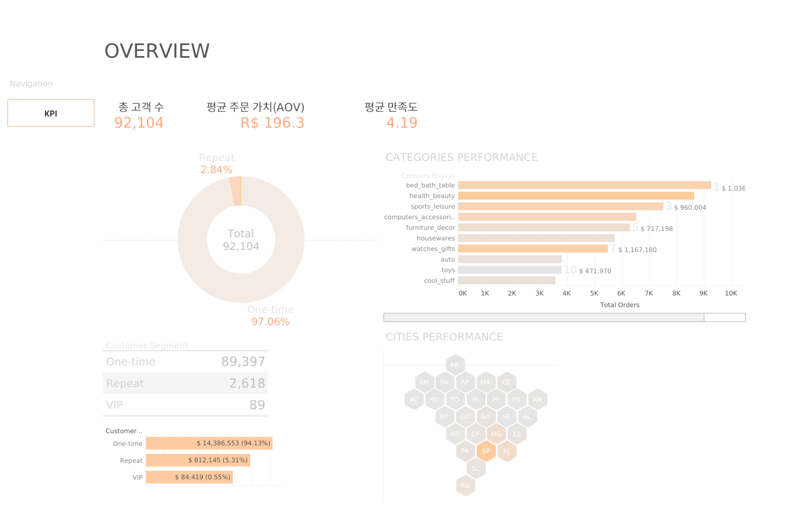

상단에는 총 고객 수·AOV·평균 만족도, 왼쪽에는 고객 세그먼트와 매출 기여, 오른쪽에는 카테고리별 실적과 지역 Hex Map을 구성했습니다. 이미지는 발표 시점의 제작 중 화면이며 당시 표시된 지표를 그대로 보존했습니다.

**[Tableau 워크북 열기](03.dashboard/storyboard_.twb)** · 대시보드 `01.서론`, `02.KPI개요`와 워크시트 8개가 포함돼 있습니다. 현재 파일의 구성을 확인했으며, Tableau 앱에서 데이터 연결과 동작을 재검증하지는 않았습니다.

- **월별 KPI:** CSV를 읽어 월별 재구매 비중, 신규·재구매 고객 수, AOV 관계, 분기별 비교를 2×2 Matplotlib 화면으로 구성하고 요약 통계를 출력했습니다.
- **What-if:** 상품 정보·배송비·크기와 색상 정보의 개선 비용과 재구매 증가폭을 가정해 단일·통합 개입, 3년 할인 거래액·ROI·민감도를 비교하는 코드를 작성했습니다.
- **Tableau 연계:** 화면 목적별 DM 6종·DIM 4종·AGG 4종, 총 14종 CSV 출력 구조와 SQL 조회·저장 함수를 작성했습니다.

이는 분석 화면·데이터 준비·시나리오 코드의 구현 범위입니다. 완료 상태와 지표 정의는 [분석 안내](docs/ANALYSIS_GUIDE.md), [지표 근거](docs/METRICS_AND_LIMITATIONS.md)를 함께 확인할 수 있습니다.

## 산출물과 완료 범위

분석 코드·SQL·시각화·발표자료와 Tableau 워크북을 작성했고, BI 연계를 위한 데이터 추출 구조를 설계했습니다. 저장된 ETL 로그에는 일부 추출 실패가 남아 있어 **14종은 출력 설계 범위**로 표기합니다. 발표 당시 Tableau 화면은 구성 중으로 표기돼 있으며, 현재 확인한 워크북에는 대시보드 2개와 워크시트 8개가 보존돼 있습니다. Plotly 원본 48개를 묶은 오프라인 뷰어는 이번 문서 갱신에서 추가한 산출물입니다.

공개 데이터 기반 분석과 전략 제안까지 수행한 프로젝트입니다. 실제 고객 대상 실험, 리텐션 상승, 매출 증가 또는 비용 절감이 검증된 운영 성과로 해석하지 않습니다.

## 데이터와 실행

- [Brazilian E-Commerce Public Dataset by Olist](https://www.kaggle.com/datasets/olistbr/brazilian-ecommerce)
- [Marketing Funnel by Olist](https://www.kaggle.com/datasets/olistbr/marketing-funnel-olist)

원본은 주문 99,441건, 주문상품 112,650행, 리뷰 99,224행, 마케팅 리드 8,000건입니다. 반복 구매는 `customer_unique_id`, 주문은 `order_id`로 구분합니다. 주문상품·결제·리뷰는 주문당 여러 행이 존재하므로 조인 전 집계 단위를 확인해야 합니다.

원본 CSV는 `data/`에 별도로 준비합니다. 환경 준비는 다음 명령에서 시작하며, 적재 매핑과 정제 스키마를 확인한 뒤 노트북을 순서대로 실행합니다.

```bash
python -m venv .venv
# 가상환경 활성화 후 필요한 분석 패키지 설치
docker compose up -d
```

전체 실행 방법과 현재 실행 제약은 [재현 안내](docs/REPRODUCIBILITY.md)에 정리했습니다. 기존 노트북의 저장 결과를 보존했으며, 이번 문서 정리에서 전체 DB 파이프라인이나 모델을 재학습하지는 않았습니다.

## 라이선스

코드는 [MIT License](LICENSE)를 따릅니다. 원본 데이터의 이용 조건은 각 데이터 제공 페이지를 확인해주세요.
