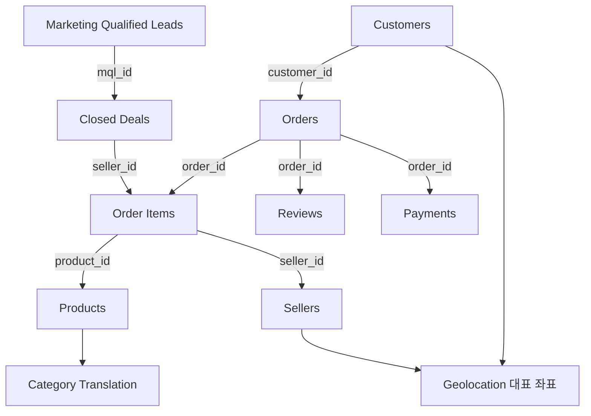

# 분석 구성과 코드 안내

[README](../README.md) · [발표 시각화](VISUALIZATIONS.md) · [지표 근거](METRICS_AND_LIMITATIONS.md) · [재현 안내](REPRODUCIBILITY.md)

## 읽는 순서

프로젝트의 결론을 이해하려면 고객 여정 → 리뷰 → 감정 분류 → 고객 개선 시나리오 → 셀러 분석 순서로 읽습니다. RFM·코호트·시장·지역 분석은 결론에 이르는 탐색과 운영 맥락을 제공합니다.

| 순서 | 분석 질문 | 주요 파일 | 확인할 내용 |
| --- | --- | --- | --- |
| 1 | 고객이 얼마나 반복 구매하는가? | [고객 여정](../01.analysis/04_Olist/고객여정.ipynb) | 구매횟수·금액별 고객 유형, 첫 주문·후속 주문 비교 |
| 2 | 만족·불만 리뷰에 어떤 표현이 나타나는가? | [리뷰 분석](../01.analysis/06_Review/01.리뷰분석.ipynb) | 평점별 텍스트·키워드·TF-IDF, 배송·고객 응대 관련 표현 |
| 3 | 평점과 텍스트가 다른 사례를 찾을 수 있는가? | [감정 예측](../01.analysis/06_Review/02.감정예측.ipynb) | 이진 감정 분류, 회귀계수, 중립·불일치 리뷰, 고객 매핑 |
| 4 | 개선 비용을 회수할 수 있는가? | [고객 시나리오](../01.analysis/06_Review/03.고객시나리오.ipynb) | 이슈별 추가 구매·투자 가정, ROI, 고객 가치 비교 |
| 5 | 계약이 실제 거래로 연결되는가? | [리드 분석](../01.analysis/07_Marketing/01.리드데이터분석.ipynb), [거래 성과](../01.analysis/07_Marketing/03.매출성과분석.ipynb) | 리드·계약·판매자 거래액의 연결 |
| 6 | 결과를 어떻게 전달하는가? | [데이터마트 추출](../02.ad_hoc/00.데이터마트생성.ipynb) | DM·DIM·AGG 설계와 CSV 저장, 실행 로그 |

이 안내는 분석을 이해하기 위한 순서입니다. 깨끗한 환경에서 전체 노트북을 자동 실행하는 파이프라인은 별도로 제공하지 않습니다.

## 데이터 연결

이 그림은 분석상 연결 관계입니다. DB에 외래키가 모두 강제돼 있다는 의미는 아닙니다. 원천 테이블의 키와 중복 여부를 확인하고 조인합니다.

| 식별자·단위 | 용도 |
| --- | --- |
| `customer_id` | 주문에 연결된 고객 레코드 식별자 |
| `customer_unique_id` | 여러 주문의 고객 이력을 연결하는 식별자 |
| `order_id` | 주문 단위 집계와 주문상품·결제·리뷰 연결 |
| `order_id × order_item_id` | 주문상품 레코드 구분 |
| `review_id × order_id` | 리뷰 매핑을 검증할 때 함께 확인할 키. `review_id` 단독은 원본에서 유일하지 않음 |
| `mql_id` | 판매자 리드와 계약 연결 |
| `seller_id` | 판매자 계약과 주문상품 거래 연결 |

## 탐색 분석의 역할

### 고객 행동과 세분화

- [RFM](../01.analysis/01_RFM/): 최근 구매·구매빈도·구매금액, 가중치, 군집·PCA, 고객 행동 비교.
- [코호트](../01.analysis/02_Cohort/): 첫 구매 월 이후 구매 활동, 첫 구매 특성 비교.
- [고객 특성 세분화](../01.analysis/03_Segmentation/고객특성기반.ipynb): 결제·카테고리·리뷰 등 행동 피처, 표준화·KMeans, RFM과 교차 비교.

반복 구매 이력이 적고 일부 분석은 주문별 고객 ID를 집계하므로, 군집을 확정된 고객 유형이나 검증된 타깃 전략으로 해석하지 않습니다. 동적 RFM의 구매 발생 월 집계는 무구매 월까지 채운 월말 스냅샷과 구분합니다.

### 시장·판매자·지역·배송

- [Olist 구조 분석](../01.analysis/04_Olist/): 매출·가격대·카테고리·판매자·지역별 패턴.
- [판매자–고객 거래](../01.analysis/05_region/seller_customer.ipynb): 동일 지역·지역 외 거래와 연결 구조.
- [배송비](../01.analysis/05_region/배송비.ipynb), [배송 성능](../01.analysis/05_region/배송성능.ipynb): 거리·무게·부피·비용·배송일·지연 비교.

우편번호별 대표 좌표를 사용한 Haversine 거리는 직선거리입니다. 실제 운송 경로, 물류비, 배송사의 내부 운영 정보를 직접 측정한 값으로 해석하지 않습니다.

### 셀러 유입·전환·성과

- [계약 전환 최적화](../01.analysis/07_Marketing/02.계약전환최적화분석.ipynb): 채널·리드 프로필·전환 소요 시간.
- [거래 성과](../01.analysis/07_Marketing/03.매출성과분석.ipynb): 계약 판매자의 관측 거래액과 지역·카테고리 비교.
- [성과 예측](../01.analysis/07_Marketing/04.성과예측.ipynb): 채널·접촉 시점의 계약 예측과 계약 이후 고매출 예측 탐색.
- [CSV 기반 예측](../01.analysis/07_Marketing/marketing_performance_prediction.ipynb): 원본 파일을 직접 읽는 별도 실험. DB 기반 노트북과 모델 성능을 혼용하지 않음.

리드의 회사·GTIN·재고 등 일부 특성은 결측이 많고, 계약 이후에만 알 수 있는 정보가 있습니다. 실제 리드 선별 모델로 사용하려면 예측 시점에 이용 가능한 변수와 병합 후 고유키를 먼저 검증해야 합니다.

## Plotly 시각화 구현과 발표 그래프

분석을 전달하기 위해 매출 트리맵·복합 차트, 지역 네트워크·Sankey·지도, 배송 히트맵·3D 지형도, 고객군 버블·레이더를 구성했습니다. 원본 노트북의 Plotly JSON 출력 48개를 [인터랙티브 뷰어](visualizations/index.html)로 보존했습니다. 노트북에 저장된 디자인 수정본도 포함한 출력 수입니다.

[발표 시각화 문서](VISUALIZATIONS.md)에는 PPT에 사용한 Plotly·Matplotlib 이미지를 크게 배치하고, 그래프별 표현 목적·원본 코드·발표 페이지를 연결했습니다. Plotly의 차트 구현과 Tableau 연계용 ETL은 각각의 산출물로 확인할 수 있습니다.

## BI용 파생 레이어

[추출 노트북](../02.ad_hoc/00.데이터마트생성.ipynb)은 Tableau 연계를 위해 다음 14종 CSV를 설계했습니다.

| 레이어 | 출력 이름 | 목적 |
| --- | --- | --- |
| DM 6종 | `dm_project_overview`, `dm_kpi_overview`, `dm_satisfaction_analysis`, `dm_review_shipping`, `dm_customer_segment`, `dm_action_planner` | 개요·KPI·만족도·배송·세그먼트·개선 시나리오 |
| DIM 4종 | `dim_customers`, `dim_time`, `dim_geography`, `dim_categories` | 고객·시간·지역·카테고리 기준 정보 |
| AGG 4종 | `agg_monthly_kpi`, `agg_regional_performance`, `agg_category_performance`, `agg_segment_performance` | 화면용 사전 집계 |

SQL 조회와 CSV 저장 함수, UTF-8 BOM 인코딩, 행·열 수 및 소요 시간 출력을 포함합니다. 저장 로그에는 성공과 실패가 함께 있으며, 로컬 `data/`에는 액션 플래너를 제외한 13종 이름의 CSV가 존재합니다. 파일 존재와 현재 코드의 전체 실행 성공은 별개입니다.

[월별 KPI](../03.dashboard/monthly_KPI.ipynb)와 [What-if](../03.dashboard/What-if.ipynb)는 Python 기반 대시보드·개선 시나리오 탐색 코드입니다. 별도로 [Tableau 워크북](../03.dashboard/storyboard_.twb)에 `01.서론`, `02.KPI개요` 대시보드와 워크시트 8개가 보존돼 있습니다. [발표 시점의 KPI 화면](assets/tableau-kpi-overview.png)을 함께 확인할 수 있습니다. 워크북 구조 확인과 현재 앱 동작·운영 배포 검증은 구분합니다.

## 용어 구분

| 용어 | 이 프로젝트에서 구분할 의미 |
| --- | --- |
| 고객 개선 후보 | 중립 리뷰 또는 고평점·부정 예측 리뷰에서 선별한 점검 대상 |
| 만족도 전환 | 불만족 경험을 개선한다는 시나리오 가정 |
| 계약 전환 | 판매자 리드가 계약으로 이어진 관측 결과 |
| 재구매율 | 관측 기간 내 2회 이상 구매한 고유 고객의 비율 |
| 코호트 리텐션 | 첫 구매 코호트의 경과 기간별 재방문 구매 비율 |
| GMV | 각 코드가 정의한 거래액. 상품금액만인지 배송비 포함인지 확인 필요 |
| CLV | 당시 시나리오에서는 관측 누적 구매금액을 대용치로 사용 |

재구매율과 코호트 리텐션, 계약률과 거래 발생률은 서로 다른 지표입니다. 수치별 정의는 [지표 근거 문서](METRICS_AND_LIMITATIONS.md)를 따릅니다.
