# 발표 시각화와 Plotly 원본 갤러리

[README](../README.md) · [분석 코드 안내](ANALYSIS_GUIDE.md)

직접 만든 발표 그래프를 분석 질문·시각화 설계·원본 코드와 함께 정리했습니다. 아래 이미지는 기존 PNG를 그대로 복사한 발표용 그래프이며, 새 데이터로 다시 그린 결과가 아닙니다. Plotly 출력이 저장된 차트는 상호작용까지 보존했습니다.

**[Plotly 원본 48개 인터랙티브 뷰어](visualizations/index.html)**

저장소를 다운로드한 후 `docs/visualizations/index.html`을 Chrome 또는 Edge에서 엽니다. DB·Python 실행이나 인터넷 연결 없이 hover, 범례 선택, 확대·이동·3D 회전, 이미지 저장을 사용할 수 있습니다. GitHub 웹에서는 HTML 소스가 표시되므로 아래 정적 이미지와 원본 노트북을 함께 제공합니다.

PPT 페이지는 검토한 31쪽 PDF의 순서입니다. **고객 여정·리뷰·시나리오·셀러 퍼널은 Matplotlib 기반**, **매출 트리맵·매출과 단가 비교·지역 네트워크 등은 Plotly 기반**입니다.

## PPT에 사용한 그래프

### 1. 고객 유형과 가치별 구성 · 7쪽

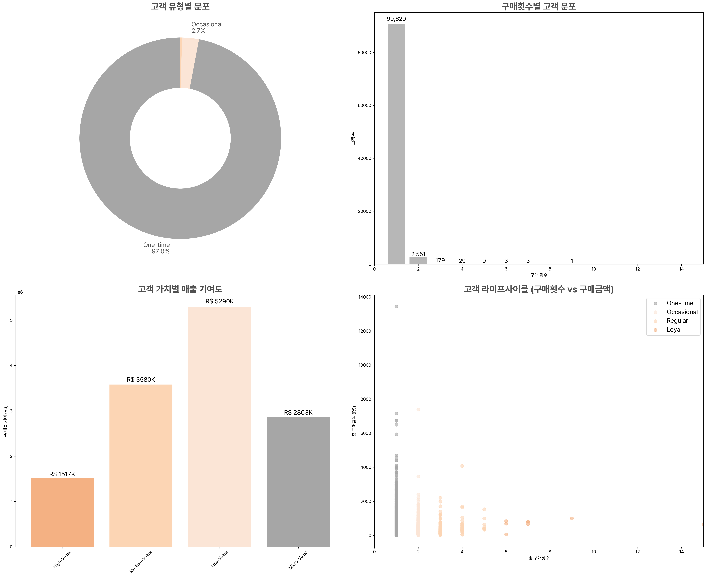

구매횟수에 따른 고객 유형과 구매금액에 따른 고객 가치를 분리하고, 도넛·막대·분포 차트를 함께 구성했습니다. 발표에서는 1회 구매 비중과 가치 구간별 매출 기여를 사용했습니다. 위 이미지는 원본의 여러 패널을 포함합니다.

**원본:** [고객 여정](../01.analysis/04_Olist/고객여정.ipynb) · **도구:** Matplotlib

### 2. 카테고리별 매출 구조 · 8쪽의 매출 분석 맥락

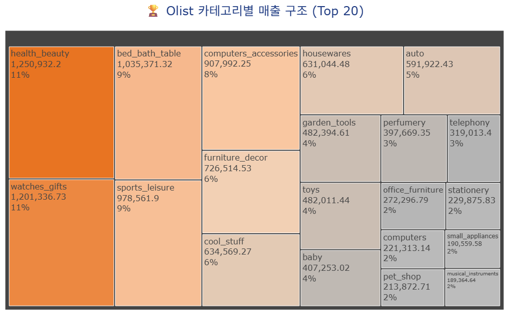

카테고리의 거래 규모를 면적으로 표현하고 오렌지·회색 계열로 강조했습니다. 카테고리 이름·금액·비중을 함께 배치해 전체 매출 구조를 한 화면에서 읽도록 구성했습니다. 같은 분석의 트리맵이며, PDF 8쪽에 직접 배치된 그림은 다음 복합 차트와 판매수량 표입니다.

**원본:** [매출 구조 분석](../01.analysis/04_Olist/매출구조분석.ipynb) · **도구:** Plotly · [인터랙티브 원본](visualizations/index.html#sales-treemap)

### 3. 매출과 평균 단가 비교 · 8쪽

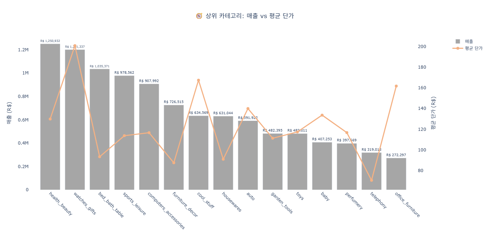

매출 막대와 평균 단가 선을 조합했습니다. 규모가 큰 카테고리와 단가가 높은 카테고리를 구분해 설명할 수 있도록 두 지표의 축·색상·범례를 배치했습니다.

**원본:** [매출 구조 분석](../01.analysis/04_Olist/매출구조분석.ipynb) · **도구:** Plotly · [인터랙티브 원본](visualizations/index.html#sales-vs-price)

### 4. 카테고리별 판매수량 · 8쪽 표의 관련 시각화

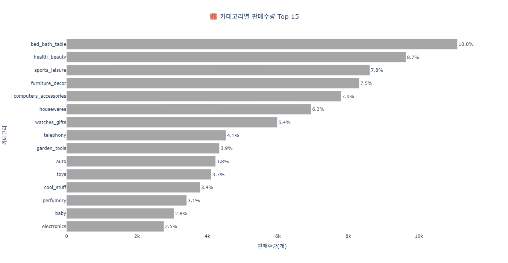

상위 카테고리의 판매량을 수평 막대로 정렬하고, 순위·카테고리·수량을 비교하도록 만들었습니다. 매출·단가 차트와 함께 볼 수 있는 별도 Plotly 그래프입니다.

**원본:** [매출 구조 분석](../01.analysis/04_Olist/매출구조분석.ipynb) · **도구:** Plotly · [인터랙티브 원본](visualizations/index.html#category-volume)

### 5. Seller–Customer 지역 네트워크 · 9쪽


지도 위에 판매자–고객 지역 연결을 표현했습니다. 노드 크기를 정규화·클리핑하고 SP·다른 허브에 강조 배수를 적용했으며, 허브 연결선도 색·굵기로 구분했습니다. 따라서 노드 표시 크기는 원시 거래량의 정확한 비례값이 아닙니다. 연결선 hover에서 거래액·건수를 확인하고 확대·이동할 수 있습니다.

**원본:** [판매자–고객 지역 분석](../01.analysis/05_region/seller_customer.ipynb) · **도구:** Plotly · [인터랙티브 원본](visualizations/index.html#seller-network)

관련 그래프에서는 로컬·원거리 거래 비중도 도넛으로 표현했습니다.

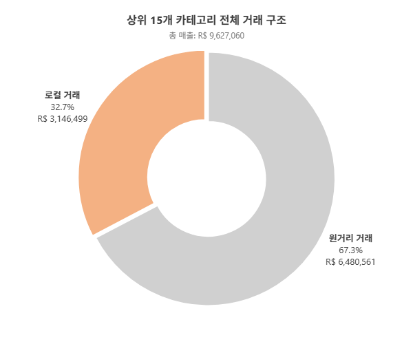

**[로컬·원거리 거래 인터랙티브 원본](visualizations/index.html#local-trades)**

### 6. 평점과 텍스트가 다른 리뷰 · 17쪽

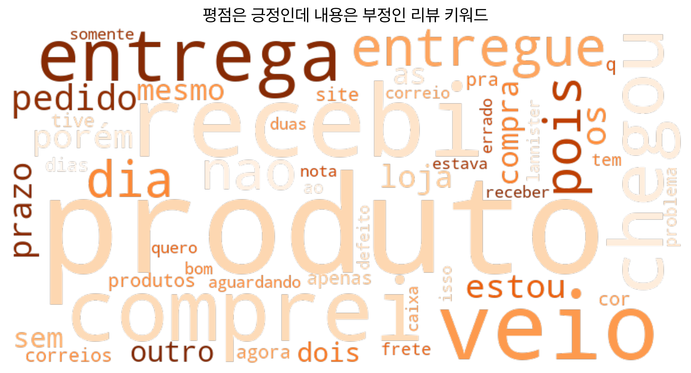

평점은 높지만 부정으로 예측된 리뷰에서 나타나는 표현을 워드클라우드로 전달했습니다. 텍스트 사례와 함께 추가 검토할 이슈를 설명하는 용도입니다. 단어가 크다는 사실만으로 불만의 인과관계나 심각도를 뜻하지는 않습니다.

**원본:** [감정 예측](../01.analysis/06_Review/02.감정예측.ipynb) · **도구:** Matplotlib·WordCloud

### 7. 고객군별 부정 요소와 차이 · 19쪽

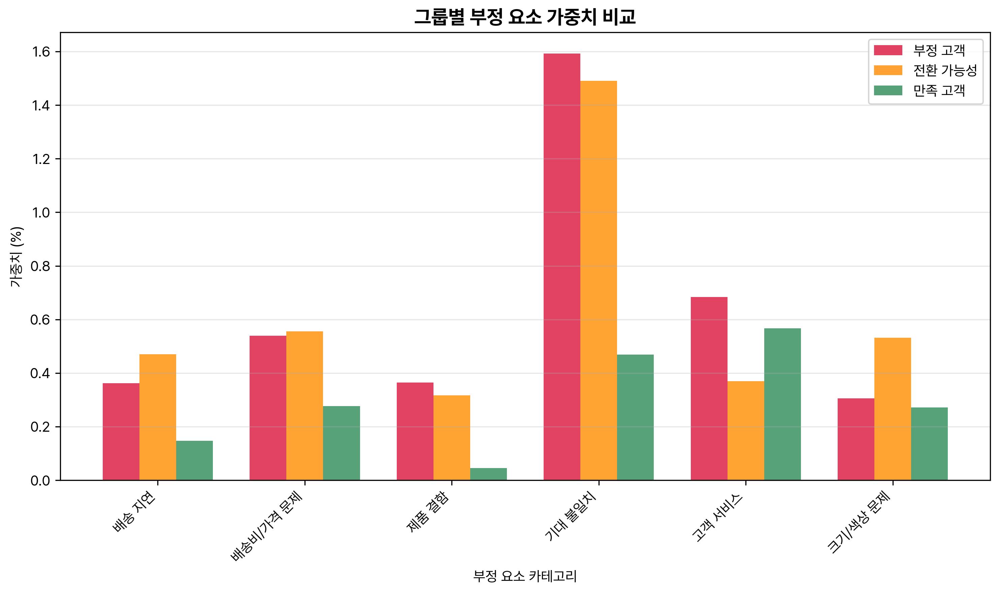

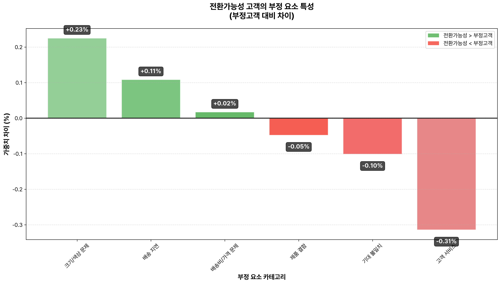

그룹별 막대 비교와 차이값 정렬을 조합하고, 차이 방향을 색으로 구분해 어떤 이슈를 우선 검토할지 설명했습니다. 키워드 규칙·가중치에 따른 탐색 지표이며 확정된 인과효과로 해석하지 않습니다.

**원본:** [감정 예측](../01.analysis/06_Review/02.감정예측.ipynb) · **도구:** Matplotlib

### 8. 고객 가치와 비용 회수 기준 · 21쪽

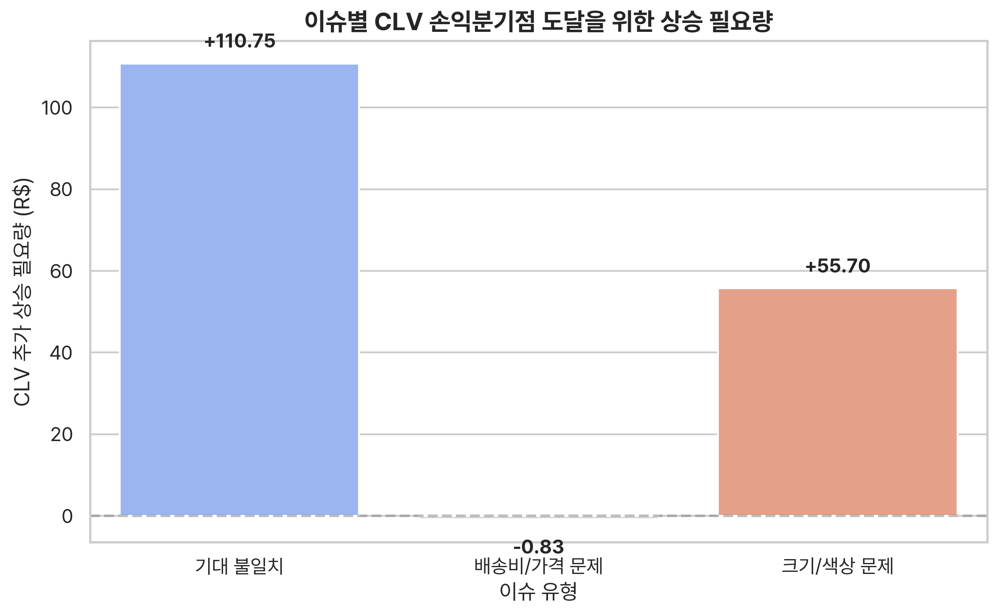

이슈별 차이를 막대와 기준선으로 표현하고 값에 레이블을 붙였습니다. 당시 CLV 대용치와 비용 가정으로 작성한 시나리오입니다. 미래 이익이나 실제 투자 회수를 검증한 결과와 구분합니다.

**원본:** [고객 시나리오](../01.analysis/06_Review/03.고객시나리오.ipynb) · **도구:** Matplotlib·Seaborn · [산식과 해석](METRICS_AND_LIMITATIONS.md#3-roi와-clv-시나리오)

### 9. 셀러 리드 채널과 전환 퍼널 · 28쪽

| 리드 유입 채널 | 리드에서 거래 관측까지 |
| --- | --- |
| 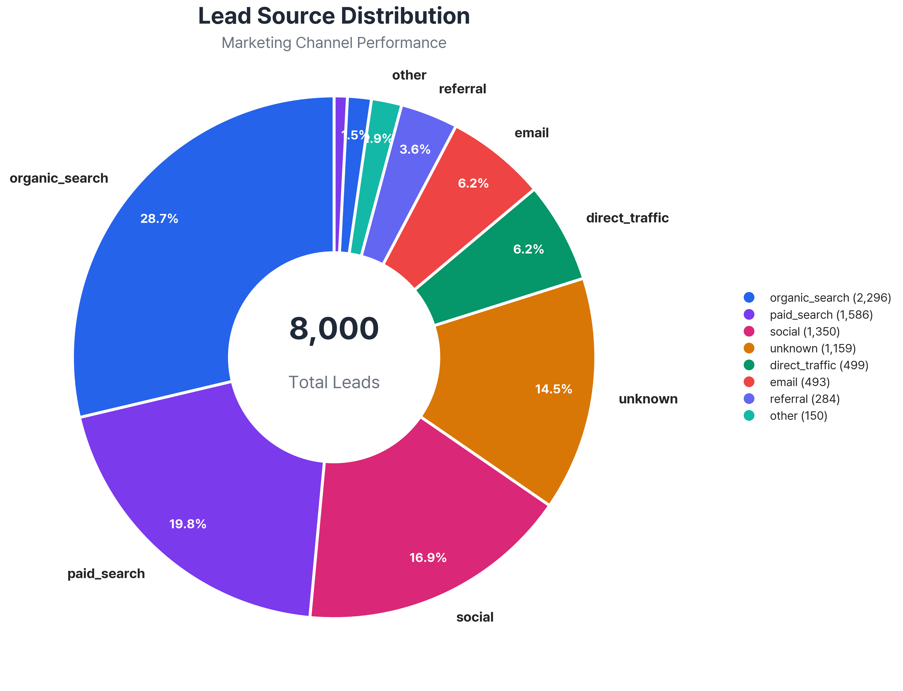 | 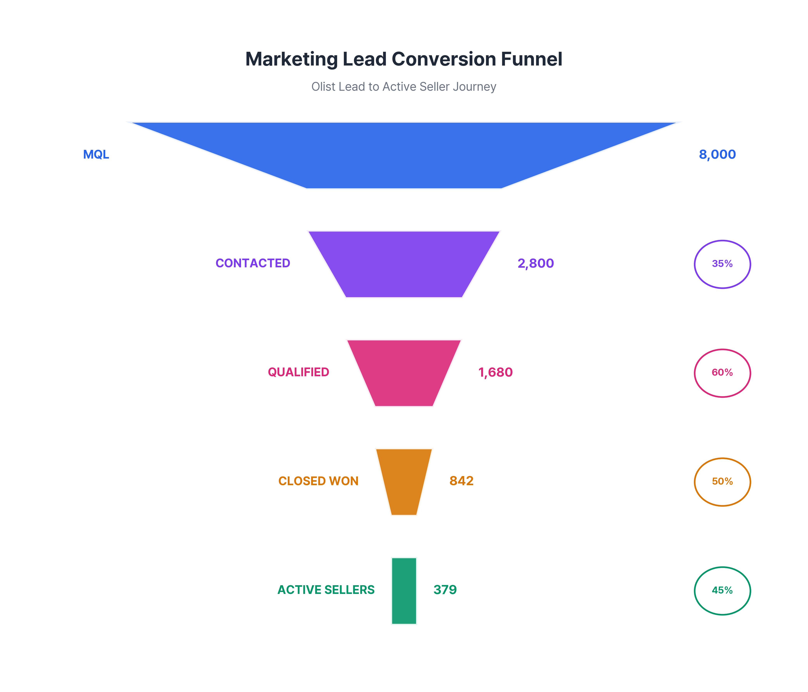 |

채널별 색상을 구분한 도넛과 단계별 수·비율을 함께 배치한 퍼널입니다. 리드·계약·거래 발생을 나누어 전달했습니다. **Contact 35%·Qualified 60%는 시각화에 사용된 가정값**이며 실제 영업 단계 측정치가 아닙니다.

**원본:** [리드 데이터 분석](../01.analysis/07_Marketing/01.리드데이터분석.ipynb), [퍼널 분석](../01.analysis/07_Marketing/05.퍼널분석.ipynb) · **도구:** Matplotlib

## Tableau 대시보드 · 발표 24쪽

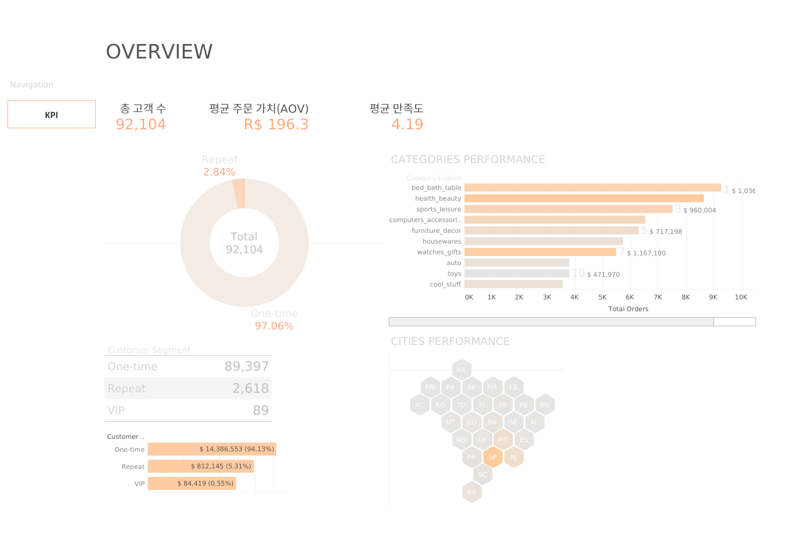

발표자료에서 실제 대시보드 이미지를 추출했습니다. 상단 KPI 카드, 고객 세그먼트 도넛·표·매출 기여도, 카테고리 실적과 지역 Hex Map을 함께 구성했습니다. 당시 발표에는 제작 중으로 표시돼 있으며, 이미지에 표시된 지표는 재계산 없이 보존했습니다.

**워크북:** [storyboard_.twb](../03.dashboard/storyboard_.twb) · **구성:** 대시보드 2개(`01.서론`, `02.KPI개요`), 워크시트 8개 · **이미지 출처:** [PDF 내 원본 위치](assets/tableau-kpi-overview.source.json)

Tableau 데이터 재연결과 현재 앱 동작은 이번 문서 검토에서 실행하지 않았습니다.

## 추가 Plotly 분석 화면

PPT에 넣은 대표 그림 외에도 데이터의 분포·흐름·지역 차이를 탐색하기 위한 차트를 구성했습니다. 아래 화면은 인터랙티브 뷰어에서 선택해 볼 수 있습니다.

| 분석 질문 | 직접 구성한 표현 | 원본 차트 |
| --- | --- | --- |
| 지역 간 거래는 어떻게 흐르는가? | 판매자 지역 → 고객 지역 Sankey | [지역 간 거래 흐름](visualizations/index.html#trade-sankey) |
| 지역별 배송 경험은 어떻게 다른가? | 성능등급 색상·주문량 버블 지도 | [지역별 배송 성능](visualizations/index.html#delivery-map) |
| 어느 지역·카테고리의 배송비 비율이 높은가? | 지역 × 카테고리 히트맵 | [배송비 효율성](visualizations/index.html#shipping-heatmap) |
| 거리·주문가치와 지연률은 어떤 관계인가? | 3D 지형도 | [배송 지연률](visualizations/index.html#delivery-surface) |
| 고객 군집은 공간상 어떻게 분포하는가? | RFM 3D 산점도 | [고객 군집](visualizations/index.html#rfm-3d) |
| 고객군별 소비 구성이 어떻게 다른가? | 정규화한 상품군 레이더 | [소비 패턴 레이더](visualizations/index.html#customer-radar) |


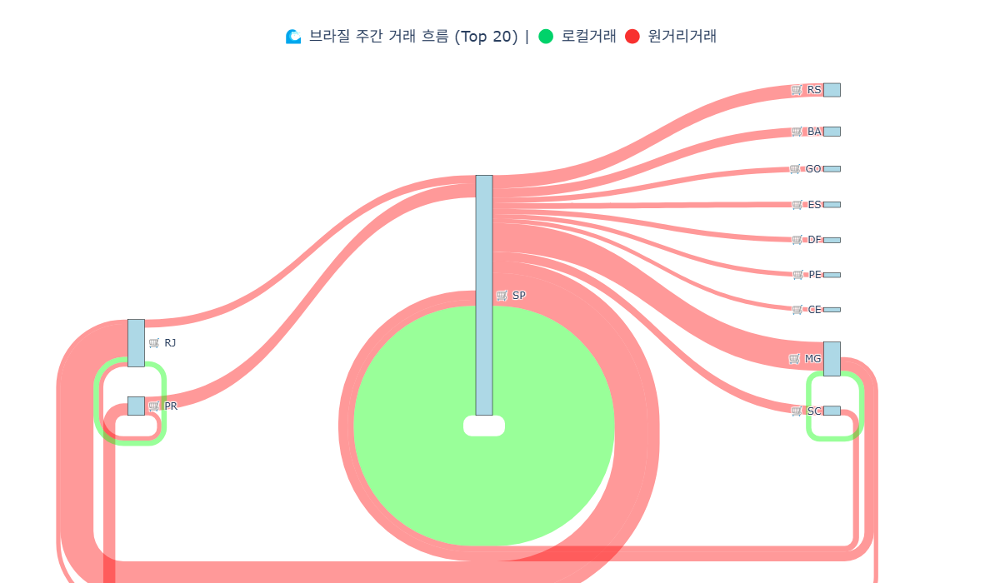

## 원본 보존과 구성

| 구분 | 차트 수 | 원본 |
| --- | ---: | --- |
| RFM·고객 행동 | 8 | 동적 RFM, RFM 군집, 행동 인사이트 |
| 매출·카테고리 | 13 | 매출 구조 분석 |
| 지역·배송 | 27 | 판매자–고객, 배송비, 배송 성능 |
| 합계 | **48** | Plotly JSON 출력이 저장된 7개 노트북 |

48개는 고유한 최종 그래프의 수가 아니라 **노트북에 저장된 Plotly 출력 수**입니다. 같은 차트의 디자인 수정본도 포함합니다. 저장된 출력이 없는 코드나 Matplotlib 이미지는 이 수에 포함하지 않습니다.

- [인터랙티브 뷰어](visualizations/index.html): 검색·분석 영역 선택·범례·확대·이미지 저장.
- [원본 목록](visualizations/manifest.json): 노트북 경로, 0부터 시작하는 셀·출력 번호, 차트 유형, 원본 JSON의 SHA-256.
- [발표 이미지 목록](assets/manifest.json): 복사한 이미지와 기존 원본 파일의 대응.
- [내보내기 코드](../scripts/export_plotly_gallery.py): 분석 셀을 실행하지 않고 저장된 Plotly JSON을 압축·보존.

노트북 출력을 갱신했다면 다음 명령으로 Plotly 데이터 묶음과 목록을 다시 생성할 수 있습니다.

```bash
python scripts/export_plotly_gallery.py
```

저장 데이터는 원본 trace·layout을 보존합니다. 뷰어는 화면 크기에 맞춰 표시 폭·높이를 조정하고 모바일에서는 제목을 차트 위에 따로 표시합니다. Plotly.js 2.35.2와 남미 지도 배경을 함께 포함했습니다. [외부 자산 출처](visualizations/vendor/NOTICE.md)를 확인할 수 있습니다.

오프라인 Chrome에서 48개 출력의 실제 렌더링, 지도 배경, 검색·영역 선택을 확인했고 모바일 가로 넘침도 점검했습니다.
